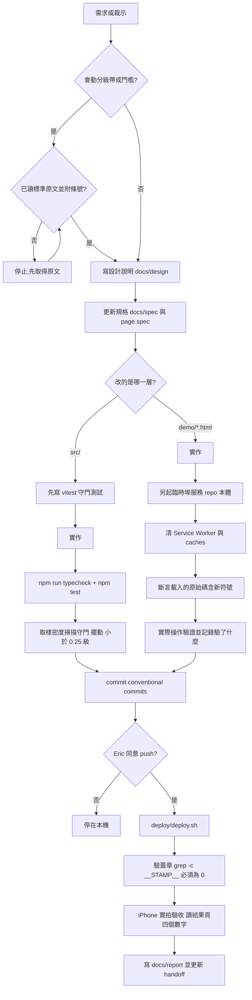
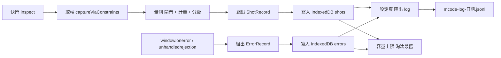

# 設計說明 20261104-1 — ISO 分級對齊、直印瓦楞 policy、拍照條件 log

> 狀態:**目標 B、C 已實作(2026-11-04,未上線);目標 A 等標準原文**。來源:Eric 2026-11-04 裁示(見 L2 `project-mcode-iso-alignment-direction`)與 `report20261104-1.md` 決策包。
> 定位護欄不變:所有等級為相對代理值,`isRelative` 恆為 `true`,不出具合規,文案不得暗示合規。

## 1. 目標與不做的事

| 項目 | 內容 |
|---|---|
| 目標 A | 參數→等級的邏輯往 ISO/IEC 15416、15415 的分級帶對齊(**待標準原文**) |
| 目標 B | `policies.ts` 的 ITF-14 加直印瓦楞欄位(Eric 已同意動 §6.1 的欄位,**既有 `requiredGrade` 門檻不動**) |
| 目標 C | 增加拍照條件 log 與錯誤檔,事後可還原「這一張是在什麼條件下判的」 |
| 不做 | 宣稱合規;把外部廠商頁的數字當規格;在沒有標準原文時改分級帶;log 收錄照片內容 |

## 2. 軟體開發流程

本專案的流程在 DoD 上有兩條分岔:改 `src/` 走自動測試,改 `demo/*.html` 走本機實際操作。下圖把兩條合在一起,並標出 §6.1 凍結與標準原文這兩個關卡。

## 3. 目標 A:ISO 分級對齊

### 3.1 現況與缺口(對照 `report20261104-1.md`)

| 項目 | 現況 | 待確認的 ISO 做法 | 狀態 |
|---|---|---|---|
| 參數→分數 | 比例 × 4(`grade.ts` `ratioToScore`) | 固定分級帶(例如 SC 依百分比分段) | 待原文 |
| Rmin | `1 − rDarkMin` 線性分數 | 通過/失敗閘門 | 待原文 |
| Decode / MinEC | 無對應硬規則 | 不過該線直接 F | 待原文 |
| 2D 非均勻性 | ANU/GNU 合成一項 | Axial NU 與 Grid NU 兩項 | 待原文 |
| 光度輸入 | 對整個 ROI 合併 | 逐掃描線 | 待原文 |

### 3.2 實作順序(每一步都要附標準條號)

1. 在 `src/domain/scale.ts` 旁新增**分級帶表**(資料,不是散在程式的常數),並附來源條號與標準版本。
2. 新增守門測試:表的每一格釘住,仿 `rules-spec-sync.test.ts`。
3. `grade.ts` 改為查表。**變更前後各跑一次取樣密度掃描**,記錄等級位移量,寫進報告。
4. 通過/失敗閘門單獨一步,因為它會讓等級**下降**,上線前要先告知 Eric(同 handoff 0b 的「等級整體位移」處理)。
5. 光度輸入逐掃描線:最後做,影響面最大。

### 3.3 風險

- 分級帶一改,所有歷史紀錄的等級語意改變。**必須搭配 3.5 的版本章**,舊紀錄標示舊版。
- 手機相機沒有校正過的反射率基準。對齊的是「邏輯形狀」,不是量測可追溯性,文案維持相對值。

## 4. 目標 B:ITF-14 直印瓦楞 policy 欄位

`AcceptancePolicy`(`src/domain/types.ts`)新增**選填**欄位,既有 policy 不填就維持現行行為:

| 欄位 | 意義 | 值的來源 |
|---|---|---|
| `directPrintXMinMm` | 直印瓦楞可接受的 X 寬下限 | **待 GS1 一般規格原文**;3M 文件寫 0.71 mm 但只讀到摘要,不採用為預設 |
| `bearerBarX` | bearer bar 寬度(X 的倍數) | 同上;外部來源有 2× 與 4.8× 衝突,**未定案前欄位留空** |
| `substrate` | 基材標記(例如 `corrugated-direct`) | 呼叫端傳入 |

規則:**欄位值在拿到原文前不得填數字**。型別與讀取路徑先做、值後填;`policy-coverage.test.ts` 加一條「選填欄位未填時行為與現行完全相同」。

## 5. 目標 C:拍照條件 log 與錯誤檔

### 5.1 為什麼需要

現況每張的取幀紀錄只進結果頁與 PDF(規格 §3.15、§3.17),**重整就消失**(稽核 C 的同一個缺口)。實機驗收需要累積「條件 → 判定」的對照,否則 §6.1 的門檻重標定沒有資料。這份 log 同時是 inbox 中「誤判率」指標的原料。

### 5.2 資料流

### 5.3 ShotRecord 欄位(只記條件與結果,**不存影像**)

| 群組 | 欄位 |
|---|---|
| 識別 | `id`、`ts`(ISO 8601)、`build`(版本章,即 SW 快取名雜湊)、`sessionId`(隨機,**不含帳號**) |
| 裝置 | `userAgent`、`facing`、`devicePixelRatio`、`orientation` |
| 相機 | `requested`(請求值)、`granted`(`getSettings()` 全文)、`analysisWidth`、`frameSource`(L1/L3) |
| 取幀時序 | `shutterDelayMs`、`settleFrames`、`focusRelativePct`、`candidates`(挑幀留痕) |
| 閘門 | 八項的 `key/status/value` |
| 幾何 | 符號別、`pxPerModule`、`tiltDeg` 與來源、`rectified` 是否使用 |
| 結果 | 總等級與分數、各參數(逐掃描線最差)、`measurability`、`freshness` |
| 標註(選填) | `humanLabel`:`good` / `bad` / 空;之後算誤判率用 |

### 5.4 ErrorRecord 欄位

`id`、`ts`、`build`、`sessionId`、`kind`(`error` / `unhandledrejection` / `camera` / `decode` / `storage`)、`message`、`stack`(截斷至 4 KB)、`where`(哪個動作)、`lastShotId`(關聯)。

### 5.5 設計決定

| 決定 | 選擇 | 理由 |
|---|---|---|
| 儲存 | IndexedDB,兩個 store | 容量比 localStorage 大;已有 SW 與快取,不引入後端 |
| 匯出格式 | JSONL | 逐行獨立,壞一行不毀整檔;易用腳本統計 |
| 上限 | 500 筆 shots、200 筆 errors,淘汰最舊 | 避免無限成長 |
| 隱私 | 不存影像、不存帳號、`sessionId` 隨機 | 現場照片與帳密不外送 |
| 登出 | **log 不隨登出清除**,但不含使用者識別 | 與 A-12 的 scans 清除不同:log 不含可辨識資料 |
| 失敗 | 寫入失敗只進記憶體並顯示一次提示,**不得阻擋快門** | 沿用 §3.12 的原則:新增的失敗路徑不可鎖死既有流程 |

### 5.6 與既有事項的關係

- **稽核 C**(掃描清單只在記憶體)仍未修。本設計不碰 `scans`,避免與 A-12 互相惡化(handoff 已警示)。
- **後端紀錄簿**(架構重評估第 4 項)日後可直接消費這份 JSONL;欄位已含 `build`,滿足「等級不可變且蓋版本章」。

## 6. 驗收(DoD)

> 逐案例的測試方案與單張檢測流程圖見 `docs/testplan20261104-1.md`(含 T1/T2/T3 案例、通過判準、結果追蹤)。

| 項目 | 判準 |
|---|---|
| 目標 B | `npm run typecheck` 與 `npm test` 通過;新欄位未填時既有測試結果完全不變 |
| 目標 C(純函式部分) | `ShotRecord`/`ErrorRecord` 的組裝、截斷、淘汰寫成純函式於 `demo/` 或 `src/export/`,附 vitest |
| 目標 C(`demo/*.html` 部分) | 臨時埠 + 清 SW 後實際操作:拍一張→匯出→檢查 JSONL 每行可解析、欄位齊全;注入一個例外→錯誤檔出現對應紀錄;寫入失敗注入→快門仍可用 |
| 目標 A | 附標準條號;分級帶表有守門測試;變更前後取樣密度掃描的位移量寫進報告 |
| 全部 | 文案守門測試(不得含 ISO/合規/不合格/印壞)仍通過 |

## 7. 決策紀錄與實作偏離

### Eric 2026-11-04 的裁示
| 問題 | 裁示 |
|---|---|
| ISO 原文 | 在 Surface Pro Laptop Studio 上,等開機後提供。**目標 A 與目標 B 的數值都卡在這裡** |
| 上限與隱私(500 / 200 筆、不含帳號) | 依建議 |
| 匯出方式 | 依建議:先做「複製到剪貼簿」(被拒時退回文字框) |
| `humanLabel` | 依建議:結果頁放兩顆選填按鈕(良品 / 不良),否則誤判率沒有人工標註可用 |

### 實作時偏離或補充設計的地方
1. **`gate` 的「未量測」表示法**:`status: "UNMEASURED"`、`value: null`。原因:`state.gate` 對未量測項留的是預設值(`pxm` 恆 9、傾角還原 0°,稽核 A-01),照記就是假讀數。第一版這樣記了,瀏覽器驗證時發現與同筆 `shotGate` 文字矛盾,已修。
2. **`tiltDeg`**:`tiltSource` 為「未量測」時記 `null`。
3. **示範模式的模擬結果不進 log**,也不顯示標註按鈕,避免汙染誤判率。
4. **匯出多一個 `type` 欄**(`shot` / `error`),讓兩種紀錄可放在同一份 JSONL。
5. **`timing.candidates`** 目前放的是既有取幀文字留痕(`frameCompare`、`shotTiming`、`shotGate` 等),不是結構化的候選幀陣列。`focusRelativePct` 與 `settleFrames` 現無來源,記 `null`。
6. **log 區塊放在 `mobile.html` 模組最前面**,模組中段才丟例外時,先前排隊的錯誤仍領得走。
7. **新增 `checkDirectPrintXDim`**(`acceptance.ts`):測試方案 T2-B3 需要一個消費者來驗邊界,否則欄位只是死資料。

### 仍待處理
- ISO 15416 / 15415 原文(目標 A)、GS1 一般規格 ITF-14 章節(目標 B 的數值)。
- 真機驗證:所有 T3 案例。
- 上線:本輪**未**執行 `./deploy/deploy.sh`,也未 push。
