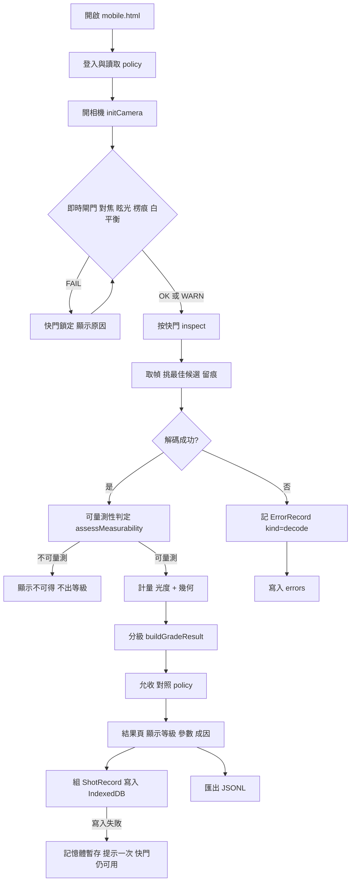
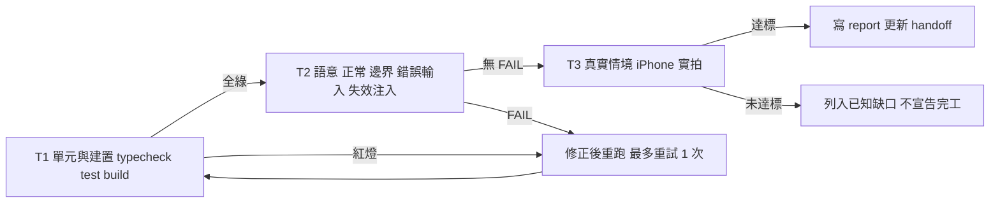

# 測試方案:ISO 分級對齊、直印瓦楞 policy、拍照條件 log — 2026-11-04

> 撰寫:Claude(依範本 `~/.claude/templates/testplan.md`)。對應設計說明 `docs/design20261104-1.md` §6。**未跑過的項目不得標通過。**
> 本方案撰寫時三個目標都**尚未實作**,結果欄除基線外一律為「未跑」。目標 A 另被「標準原文」擋住,標「阻擋」。

## 1. 範圍
- 納入:
  - 目標 A:參數→等級的分級帶表、Rmin/Decode/MinEC 閘門、2D 軸向/網格非均勻性分項、光度逐掃描線。
  - 目標 B:`AcceptancePolicy` 新增選填欄位 `directPrintXMinMm`、`bearerBarX`、`substrate`。
  - 目標 C:`ShotRecord` / `ErrorRecord` 的組裝、截斷、淘汰、匯出,以及寫入失敗時快門不受影響。
  - 既有 635 個測試作為回歸基線。
- 不納入(與原因):
  - 影像演算法本身(`roi1DMetrology` 等):本輪不改。
  - 後端紀錄簿與稽核 C(掃描清單持久化):設計已明列不碰,避免與 A-12 互相惡化。
  - 任何允收門檻(`requiredGrade`)數值:§6.1 凍結仍有效,只新增欄位。
  - 標準原文未取得前的目標 A 數值:案例已定義結構,預期值待條號填入。

## 2. 環境
- 機器:Mac mini(開發與 vitest);iPhone 14 Pro Safari(T3 實拍)。
- 版本:以 `git rev-parse --short HEAD` 與頁面快門下方的版本章為準,測試時兩者都要記。
- 自動化:`npm run typecheck`、`npm test`(vitest)、`npm run build`。
- `demo/*.html` 驗證:另起臨時埠(例 `python3 -m http.server 8799 --bind 127.0.0.1`)服務 repo 本體,**不用 8765**(docroot 與線上相同,等於先發佈再驗證)。每次換新埠或先清 Service Worker 與 caches,並**先斷言載入的原始碼含新符號**才開始操作。
- 實拍資料:ITF-14 瓦楞箱實物,至少 10 張,涵蓋對焦良好、失焦、傾斜、強眩光、低對比牛皮紙;每張由人工先標「良 / 不良」再看系統判定。存放:拍攝原圖留在手機,不進 repo、不上傳;只保留匯出的 JSONL(不含影像、不含帳號)。

## 3. 檢測流程

### 3.1 單張檢測的執行流程(本方案要覆蓋的路徑)

### 3.2 測試流程(各層級的進出條件)

## 4. 案例

結果欄圖例:`未跑` 尚未執行;`阻擋` 前置條件未滿足;`通過` 與 `FAIL` 只在親自執行並有輸出證據後填寫。

### 4.1 基線與建置

| ID | 層級 | 案例 | 前置 | 步驟 | 預期 | 自動化 | 結果 |
|---|---|---|---|---|---|---|---|
| T1-00 | T1 | 回歸基線 | 工作區乾淨 | `npm run typecheck && npx vitest run && npm run build` | 型別零錯誤;既有測試全數通過;dist 產出 | vitest | 通過(2026-11-04,commit a9d9613,24 檔 635 測試;本輪加碼後 26 檔 686 測試亦通過) |

### 4.2 目標 A:ISO 分級帶對齊(前置:標準原文與條號)

| ID | 層級 | 案例 | 前置 | 步驟 | 預期 | 自動化 | 結果 |
|---|---|---|---|---|---|---|---|
| T1-A1 | T1 | 分級帶表每一格被釘住 | 原文條號已填入表 | 新增 `bands` 守門測試,逐格斷言 | 表值與條號表一致;改表即紅燈 | vitest | 阻擋 |
| T1-A2 | T1 | 每個參數都有對應帶 | 同上 | 迭代所有 `ParameterKind` 代碼 | 無缺漏,缺一個即失敗 | vitest | 阻擋 |
| T2-A1 | T2 正常 | 各參數中間值落在預期字母 | 同上 | 每帶取中間值餵 `buildGradeResult` | 字母與表一致 | vitest | 阻擋 |
| T2-A2 | T2 邊界 | 帶邊界值(剛好等於、差 ε) | 同上 | 每個切點取 cut、cut−ε、cut+ε | 恰在切點進高一級;無浮點誤判 | vitest | 阻擋 |
| T2-A3 | T2 邊界 | 全 0、全 1、單一參數為 0 | 同上 | 餵極端比例 | 不丟例外;1D 取最差、2D 取最低 | vitest | 阻擋 |
| T2-A4 | T2 錯誤輸入 | NaN、Infinity、負值、null、undefined | 同上 | 餵進光度與幾何輸入 | 落在嚴側(F 或不可得),不得自動放行 | vitest | 阻擋 |
| T2-A5 | T2 | Rmin 通過/失敗閘門 | 原文確認 Rmin 規則 | 條反射率高於門檻的掃描線 | 該線 F,其他參數再好也 F;總分為各線平均 | vitest | 阻擋 |
| T2-A6 | T2 | Decode / MinEC 閘門 | 同上 | 解碼失敗或 MinEC 不足的掃描線 | 該線 F | vitest | 阻擋 |
| T2-A7 | T2 | 2D 軸向與網格非均勻性分開計 | 同上 | 兩者給不同值 | 各自出一項,總分取最低 | vitest | 阻擋 |
| T2-A8 | T2 | 取樣密度掃描 | 無 | 同一張合成圖 6.0 到 14.0 px/元素,0.1 步進 | 等級擺動小於 0.25 級(既有守門規則) | vitest `imgproc.test.ts` | 通過(`imgproc.test.ts`「ITF-14:6.0→14.0 px/元素 連續掃描,擺動 < 0.25 級」等 3 測試,本輪單獨執行) |
| T2-A9 | T2 | 變更前後等級位移紀錄 | 目標 A 實作完成 | 同一組合成圖在新舊分級帶各跑一次 | 位移量寫進報告;下降者上線前告知 Eric | vitest + 報告 | 阻擋 |
| T2-A10 | T2 | 文案不得暗示合規 | 無 | 既有文案守門測試 | 不含 ISO/合規/不合格/印壞字樣;`isRelative` 恆為 true | vitest | 通過(`imgproc.test.ts` 兩條定位護欄文案測試,本輪單獨執行) |
| T2-A11 | T2 | 光度逐掃描線 | 原文確認 | 各線反射率不同的合成圖 | 每線用自己的 SC/MOD,而非合併值 | vitest | 阻擋 |

### 4.3 目標 B:ITF-14 直印瓦楞 policy 欄位

| ID | 層級 | 案例 | 前置 | 步驟 | 預期 | 自動化 | 結果 |
|---|---|---|---|---|---|---|---|
| T1-B1 | T1 | 型別通過 | 實作完成 | `npm run typecheck` | 新欄位為選填,既有呼叫端零修改 | tsc | 通過(`npm run typecheck` 零錯誤) |
| T1-B2 | T1 | 每種符號別仍有 policy | 無 | `policy-coverage.test.ts` | 通過 | vitest | 通過(`policy-coverage.test.ts` 在 26 檔全量中通過) |
| T2-B1 | T2 正常 | 欄位未填時行為與現行完全相同 | 實作完成 | 同一組輸入,新舊程式比對 | 輸出逐欄相同 | vitest | 通過(`direct-print-policy.test.ts` 21 測試) |
| T2-B2 | T2 正常 | 欄位填入後被讀取 | 同上 | 建 `substrate=corrugated-direct` 的 policy | 呼叫端取得該欄位,值原樣 | vitest | 通過(`direct-print-policy.test.ts` 21 測試) |
| T2-B3 | T2 邊界 | X 寬剛好等於下限、差 ε | 同上 | 餵量測 X 寬 | 等於下限判通過;小於判不足 | vitest | 通過(`direct-print-policy.test.ts` 21 測試) |
| T2-B4 | T2 錯誤輸入 | 下限為負、NaN、0、字串 | 同上 | 建 policy 並使用 | 拒絕或視為未設定,不得靜默採用 | vitest | 通過(`direct-print-policy.test.ts` 21 測試) |
| T2-B5 | T2 | `substrate` 為未知值 | 同上 | 傳入未定義字串 | 視為未設定,不丟例外 | vitest | 通過(`direct-print-policy.test.ts` 21 測試) |
| T2-B6 | T2 | 欄位值不得先於原文填入 | 無 | 檢查 `policies.ts` | 未取得 GS1 原文前,`directPrintXMinMm` 與 `bearerBarX` 為空 | vitest 或人工審 | 通過(`direct-print-policy.test.ts` 21 測試) |
| T2-B7 | T2 | 既有門檻不動 | 無 | 斷言各 policy 的 `requiredGrade` | ITF14=C、GS1_128=B、其餘=C | vitest | 通過(`direct-print-policy.test.ts` 21 測試) |

### 4.4 目標 C:拍照條件 log 與錯誤檔

| ID | 層級 | 案例 | 前置 | 步驟 | 預期 | 自動化 | 結果 |
|---|---|---|---|---|---|---|---|
| T1-C1 | T1 | 純函式可在 Node 載入 | 實作完成 | vitest import 組裝模組 | 不依賴 DOM 或 IndexedDB | vitest | 通過(`shotlog.test.ts` 直接在 Node 載入;公開入口匯出已測) |
| T2-C1 | T2 正常 | 組出 `ShotRecord` | 同上 | 餵一組完整量測 | 設計 §5.3 所有群組欄位齊全;`ts` 為 ISO 8601;`build` 非空 | vitest | 通過(`shotlog.test.ts` 30 測試) |
| T2-C2 | T2 正常 | 組出 `ErrorRecord` | 同上 | 餵 Error 物件 | 含 `kind`、`message`、`stack`、`where`、`lastShotId` | vitest | 通過(`shotlog.test.ts` 30 測試) |
| T2-C3 | T2 邊界 | stack 超過 4 KB | 同上 | 餵 10 KB 的 stack | 截斷在 4 KB,並標示已截斷 | vitest | 通過(`shotlog.test.ts` 30 測試) |
| T2-C4 | T2 邊界 | 第 501 筆 shot、第 201 筆 error | 同上 | 連續寫入 | 淘汰最舊,筆數維持上限,最新在 | vitest(fake store) | 通過(`shotlog.test.ts` 30 測試) |
| T2-C5 | T2 邊界 | 匯出空 log | 同上 | 無資料時匯出 | 產出空檔或明確提示,不丟例外 | vitest | 通過(`shotlog.test.ts` 30 測試) |
| T2-C6 | T2 正常 | JSONL 每行可獨立解析 | 同上 | 匯出後逐行 `JSON.parse` | 全部成功;含換行或引號的 message 不破壞行格式 | vitest | 通過(`shotlog.test.ts` 30 測試) |
| T2-C7 | T2 | 不收錄影像 | 同上 | 掃描序列化結果 | 不含 `data:` URI、不含 ImageData、無 base64 長字串 | vitest | 通過(`shotlog.test.ts` 30 測試) |
| T2-C8 | T2 | 不含帳號 | 同上 | 用帳號 admin 登入後記錄 | 序列化結果不出現帳號字串 | vitest | 通過(`shotlog.test.ts` 30 測試) |
| T2-C9 | T2 | `sessionId` 隨機且同 session 固定 | 同上 | 建兩個 session | 兩者不同;同 session 內相同 | vitest | 通過(`shotlog.test.ts` 30 測試) |
| T2-C10 | T2 錯誤輸入 | 量測值含 NaN、null、undefined | 同上 | 組 `ShotRecord` | 序列化為明確的「不可得」表示,不產生 `null` 洩漏或 `NaN` 字串 | vitest | 通過(`shotlog.test.ts` 30 測試) |
| T2-C11 | T2 失效注入 | IndexedDB 不可用(私密視窗) | 臨時埠 + 清 SW | 注入 `indexedDB` 拋錯 | 提示一次,快門仍可按、結果頁正常 | 人工(瀏覽器) | 通過(瀏覽器:`indexedDB` 設為 undefined → 檢驗完成顯示 A 級,提示出現一次,紀錄留記憶體可匯出,無致命橫幅) |
| T2-C12 | T2 失效注入 | 寫入時配額已滿 | 同上 | 注入 QuotaExceeded | 同 C11;不阻擋快門 | 人工 | 通過(瀏覽器:`transaction` 注入 QuotaExceededError → 提示出現、不阻擋;**未驗**真實配額已滿) |
| T2-C13 | T2 失效注入 | 注入未捕捉例外與 rejected promise | 同上 | 在頁面觸發 `throw` 與 `Promise.reject` | 致命橫幅仍出現;errors store 新增對應紀錄 | 人工 | 通過(瀏覽器:注入 throw 與 Promise.reject → 致命橫幅出現,errors 新增 2 筆含 stack) |
| T2-C14 | T2 | 登出行為 | 同上 | 登入→拍→登出→換帳號 | 掃描清單與表頭被清(A-12 不退步);log 保留且仍不含帳號 | 人工 | 通過(瀏覽器:登出後清單歸零、log 2 筆保留、標註入口收起、匯出不含帳號) |
| T2-C15 | T2 | 錯誤紀錄關聯到最近一張 | 同上 | 拍一張後觸發錯誤 | `lastShotId` 指向該張 | vitest + 人工 | 部分:`buildErrorRecord` 帶 `lastShotId` 已測;頁面端「拍後出錯 → 關聯」**未驗** |
| T2-C16 | T2 | 新增的失敗路徑不鎖死既有流程 | 同上 | 組裝函式拋例外 | 以 try/catch 吞掉並記錄;快門與結果頁不受影響 | 人工 | 未跑(`logShot` 內有 try/catch,但沒有注入組裝例外來驗證) |

### 4.5 真實情境

| ID | 層級 | 案例 | 前置 | 步驟 | 預期 | 自動化 | 結果 |
|---|---|---|---|---|---|---|---|
| T3-01 | T3 | iPhone 實拍 ITF-14,log 與畫面一致 | 上線章已確認、已按「有新版本可用」 | 拍至少 10 張,各人工標良/不良,匯出 JSONL | 每張一行;`granted` 與結果頁印出的串流尺寸相同;`build` 與快門下方版本章相同 | 人工 | 未跑 |
| T3-02 | T3 | 條件與判定可還原 | T3-01 完成 | 抽 3 張,只看 JSONL 還原「為什麼是這個等級」 | 光看 log 即可指出拖低等級的參數與閘門狀態 | 人工 | 未跑 |
| T3-03 | T3 | 實機錯誤出口 | 同上 | 拔掉相機權限或遮住鏡頭造成錯誤 | errors 有紀錄,含 `kind=camera`;畫面有可複製的錯誤訊息 | 人工 | 未跑 |
| T3-04 | T3 | 誤判率原料可用 | T3-01 完成 | 用腳本統計「系統判 NG 而人工標良」占比 | 腳本輸出與手算逐格相符;資料量不足時標「尚未量測」 | 腳本 + 人工 | 未跑 |
| T3-05 | T3 | 目標 A 對實拍的影響 | A 實作完成 | 同一批照片前後各判一次 | 位移量記入報告;若 ITF-14 通過率下降,先告知 Eric | 人工 | 阻擋 |
| T3-06 | T3 | 瓦楞直印 ITF-14 尺寸判定 | B 欄位已填入 | 量得 X 寬小於 1.016 mm 的實箱 | 以直印下限判定,而非 100% 規格;不暗示合規 | 人工 | 阻擋 |

## 5. 真實情境驗證(DoD 第 2 點)

- 資料:T3-01 的 10 張以上 ITF-14 實拍。實拍原圖留在手機,不進 repo。
- 執行者:Eric(持有 iPhone 與實箱)。我負責寫統計腳本與核對。
- 判定「符合」:
  - 功能性:T3-01、T3-02、T3-03 全數符合預期。
  - 數字型指標:**誤判率** = NG 判定中人工標「良」的張數 ÷ 系統判 NG 的張數。分母為 0 時回報「無法計算」。資料量不足時標「尚未量測」,**不得用合成圖宣稱達標**(inbox 工單 20261026 的明文規定)。
  - 量測方法:匯出 JSONL → 腳本只讀 `humanLabel` 與總等級是否低於該 policy 的 `requiredGrade`。
- 本方案不調整任何門檻;實拍結果只用來描述,不用來當場改數字。

## 6. 非功能

- 效能 / 容量:500 筆 shots、200 筆 errors 的寫入與匯出在手機上不得讓快門延遲明顯變長。量法:有無 log 兩種情況各拍 10 張,比對 `shutterDelayMs`,記錄差值。
- 安全:
  - 序列化後掃描:無影像資料、無帳號、無 token。
  - 匯出的檔案不含 `userEmail` 等識別資料。
- 回復:
  - 重新整理後 log 仍在(IndexedDB 持久)。
  - 寫入中斷(關分頁)不得留下無法解析的半行;JSONL 以整筆寫入為單位。
- 部署:不在本方案範圍;上線走 `./deploy/deploy.sh`,並以 `grep -c __STAMP__` 驗蓋章為 0。

## 7. 通過判準

全部 T1 綠燈 + T2 無 FAIL + T3 達標 + `npm run typecheck` 通過;未達者列入「已知缺口」,不得宣告完工。
目標 A 在取得標準原文並填入條號前,整組案例維持「阻擋」,**不得因此宣告目標 A 完成**。

## 8. 結果與缺口

| 日期 | 版本 / commit | 通過 / 總數 | 缺口 |
|---|---|---|---|
| 2026-11-04 | a9d9613(基線) | 1 / 46 | 僅基線 |
| 2026-11-04 | a9d9613 + 本輪未 commit 變更 | **27 通過 · 1 部分 · 5 未跑 · 13 阻擋 / 46**;`typecheck`、`build` 零錯誤,vitest 26 檔 686 測試通過(+51) | 見下 |

**缺口(誠實列出)**
- T3-01 ~ T3-04:需要 iPhone 實拍,**一張都沒拍**。log 在假相機探針上驗過,在真機上沒驗過。
- T2-C15 頁面端關聯、T2-C16 組裝例外注入:未驗。
- T2-C12 只驗了「寫入丟 QuotaExceededError 時不阻擋」,沒驗真實配額已滿。
- 目標 A 全部 11 案與 T3-05、T3-06:阻擋,等 ISO 原文與 GS1 原文。
- `shutterDelayMs` 在背景分頁不可信(handoff 已記載);探針量到的 24 ms 不是有效時間量測。

**驗證中發現並已修正的問題**
- 第一版 `gate` 陣列把「未量測」的項目也記成數字(`resolution` 記 9、`picket`/`perspective` 記 0、`tiltDeg` 記 0),與同筆的 `shotGate` 文字互相矛盾。已改為未量測項記 `status: "UNMEASURED"`、`value: null`,`tiltDeg` 在來源為「未量測」時記 null。修正後以假相機重跑,`perspective:UNMEASURED:null`、`tiltDeg:null`、`pxPerModule:8`(實測)。
- 第一版 log 區塊放在模組中段,模組更早丟例外時排隊的錯誤領不走。已移到模組最前面。

**驗證方式與範圍**:另起 8811 loopback 埠服務 repo 本體(未動 8765/線上),先確認載入的原始碼含新符號再操作;假相機探針為 `canvas.captureStream`,驗完已刪並確認線上 404;未上線、未蓋章。
